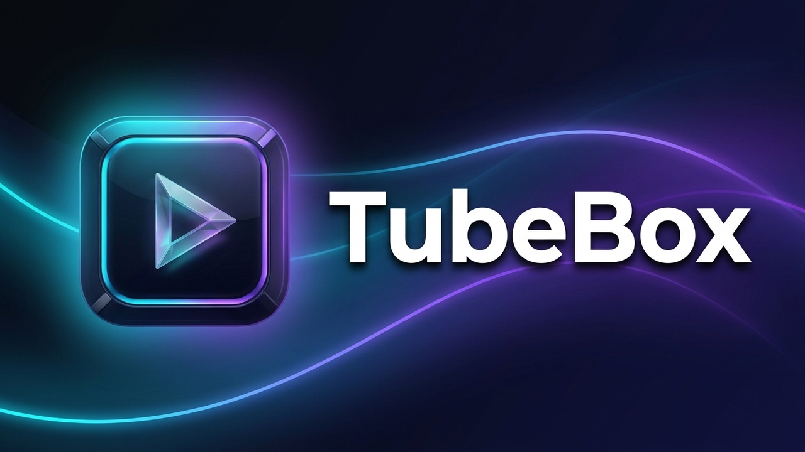
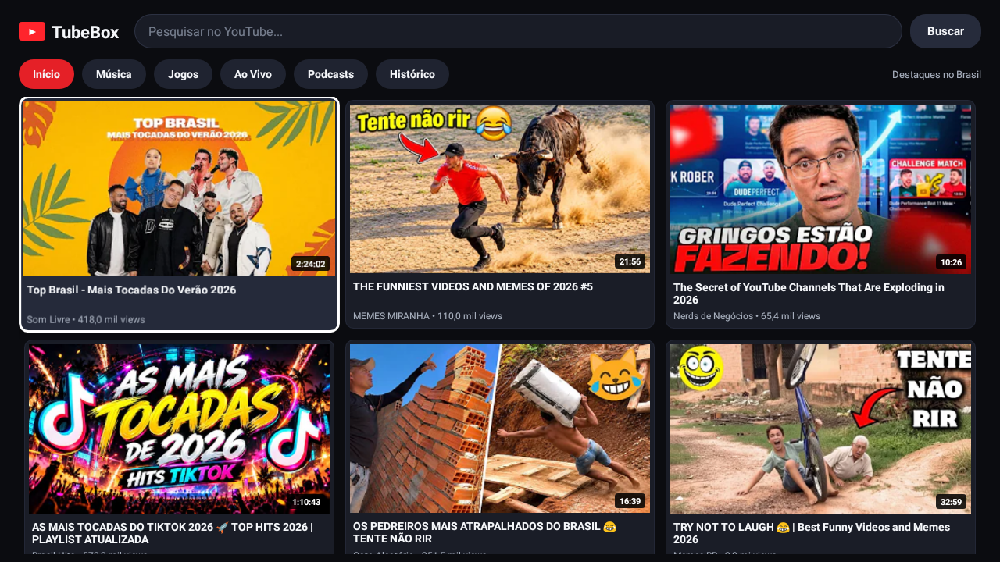
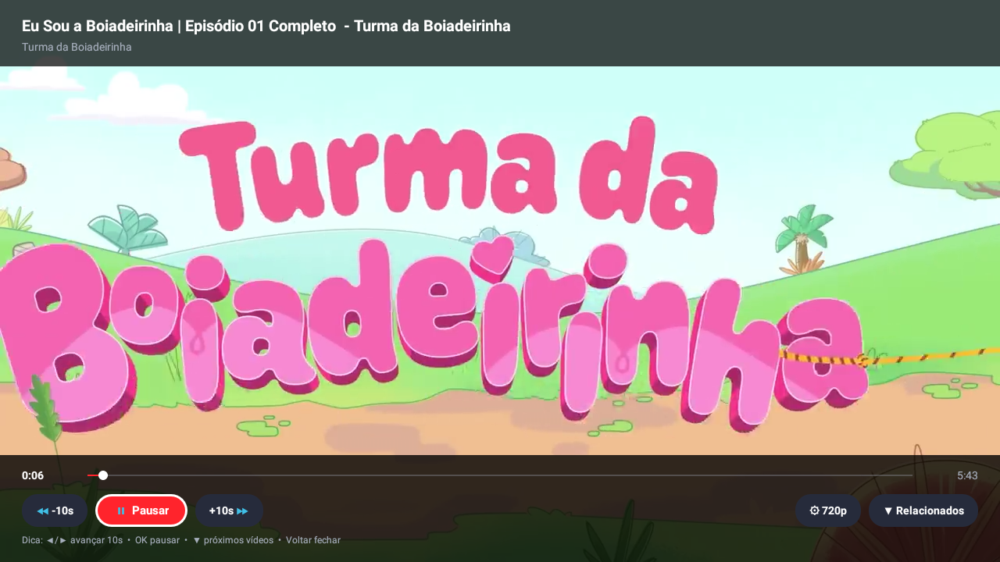

<p align="center">
  
</p>

<h1 align="center">TubeBox</h1>

<p align="center">
  <strong>Aplicativo nativo, leve e direto ao ponto para assistir vídeos do YouTube em TV Boxes Android (incluindo Android 7.1 / Rockchip RK3229).</strong>
</p>

<p align="center">
  <a href="https://github.com/DevTETEU/TubeBoxTV/releases/latest">
    
  </a>
  
  
</p>

---

## ✨ Por que o TubeBox?

Muitas TV Boxes antigas ou de entrada (como **InXplus / MXQ Pro com chip RK3229 e Android 7.1.2**) possuem WebView antigo (Chrome 52) e não conseguem rodar o aplicativo oficial do YouTube nem a Play Store.

O **TubeBox** foi construído **100% em Android nativo (Kotlin + Media3 ExoPlayer)** para resolver exatamente isso:
- 🚀 **Ultra leve (~10 MB):** consome pouquíssima RAM e abre em menos de 1 segundo.
- 🎬 **Decodificação por Hardware (H.264 / VP9):** escolhe automaticamente fluxos 720p H.264/VP9 + áudio AAC e evita AV1 por software para não engasgar processadores ARM 32-bit (`armeabi-v7a`).
- 👶 **Compatível com todos os vídeos (inclusive infantis):** utiliza extração via NewPipeExtractor com fallback automático InnerTube (`ANDROID_KIDS` / `ANDROID_VR` / `IOS`).
- 🎮 **Feito para controle remoto (D-Pad):** foco de alto contraste, navegação intuitiva pelas setas, suporte a mouse e teclado.
- 🔒 **Zero rastreadores, sem login, sem Google Play Services:** o histórico dos últimos 40 vídeos fica salvo apenas localmente na sua TV Box.
- 🔄 **Aviso de atualização integrado:** verifica automaticamente novas versões no GitHub Releases.

---

## 📸 Capturas de Tela (reais na TV Box 1280×720)

| Tela Inicial & Busca | Player em Tela Cheia (720p H.264 Hardware) |
| :---: | :---: |
|  |  |

---

## 🎮 Controles no Player

| Botão no Controle Remoto | Ação |
| :--- | :--- |
| **OK / Enter / Espaço** | Pausar ou continuar |
| **◀ / ▶** | Voltar ou avançar **10 segundos** |
| **▲ (Cima)** | Abrir barra de controles (tempo, **⚙ Qualidade** 1080p/720p/480p/360p) |
| **▼ (Baixo)** | Abrir faixa de **Próximos vídeos (Relacionados)** |
| **Voltar** | Fecha controles/relacionados ou retorna à lista |

---

## 📥 Como Instalar na TV Box

### Opção 1 — Pelo app Downloader na TV Box (mais fácil)
1. Acesse a página de [**Releases**](https://github.com/DevTETEU/TubeBoxTV/releases/latest) e baixe o arquivo **`TubeBox-v1.0.0.apk`**.
2. Na TV Box, permita a instalação de fontes desconhecidas e instale o APK.

### Opção 2 — Via ADB pelo computador
```powershell
adb connect <IP_DA_TV_BOX>:5555
adb install -r TubeBox-v1.0.0.apk
```

### Compilar a partir do código-fonte
```powershell
.\build_and_install.ps1 -DeviceIp "192.168.1.4"
```

---

## 📄 Privacidade e Licença

- Leia nossa [Política de Privacidade](PRIVACY_POLICY.md).
- Distribuído sob a licença **GNU General Public License v3.0 (GPLv3)** — veja [LICENSE](LICENSE).
- Este projeto é independente e não é afiliado ao YouTube ou ao Google.
